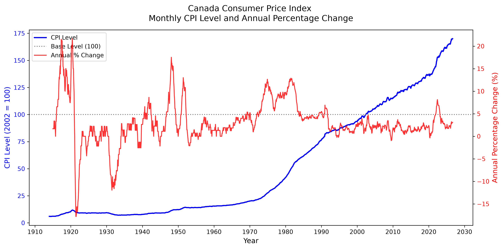

# FINE3300-2026-A2

## Description

This project is Assignment 2 for FINE 3300.

The program analyzes Canadian Consumer Price Index (CPI) data and calculates inflation between two selected dates given by the user and converts the given amount between those dates.

## Project Files

Inflation_calculator.py: Inflation calculator that also generates a graphical representation of the data.

CPI_Data.csv: Monthly CPI data from the Bank of Canada's inflation calculator.

cpi_graph.png: Generated CPI Graph.

## Installation and Usage

Step 1: Install Python and the required packages:

python -m pip install pandas numpy matplotlib

Step 2: Run the program from the project folder.

Step 3: The program displays a CPI graph and then asks for a price in CAD and two dates in YYYY-MM format. 

Step 4: Results are generated.

## Walkthrough

Step 1: Program imports necessary data analysis and visualization libraries, pandas, numpy, and matplotlib. 

Step 2: Program takes the csv data and prepares it for use in the calculator and graph creation.

Step 3: Program takes the data frame and creates a graph from it using matplotlib.

Step 4: Program prompts user for input and takes the date values and uses them to select the corresponding CPI values in the data frame for use in calculations. Also runs validations to ensure the dates entered are within the CPI data and there is no division by 0.

Step 5: Program uses the inputs to find the price on the end date, percentage change, number of years, and average annual rate of change.

Step 6: Program prints out the results to the user.

## CPI Graph



The graph shows the Canadian CPI (blue) and annual inflation rate (red). The dotted line represents the CPI base level of 100 (2002 = 100).

CPI has generally increased over time, with particularly high inflation during the 1970s-1980s, and 2021-2022 due to COVID-19. The annual inflation rate fluctuates back and forth throughout, with a huge dip around 1920 from highs during the late 1910s. From there, the annual percentage change looks to be generally consistent within the 0-5% range in more recent times, starting in the 1990s, when the Bank of Canada began targeting inflation.

## Sample Calculator Output

Example: $1,000 CAD from January 2015 to January 2025.

```text
Generating CPI graph...
Graph saved as: cpi_graph.png
Close the graph window to continue

============================================================
       BANK OF CANADA STYLE INFLATION CALCULATOR

Enter price ($): 1000
Enter first date (YYYY-MM): 2015-01
Enter second date (YYYY-MM): 2025-01

RESULTS
------------------------------------------------------------
Original price in 2015-01: $1,000.00 CAD
Equivalent price in 2025-01: $1,297.67 CAD
Percentage change: 29.77%
Number of years: 10.0
Average annual rate of change: 2.64%
CPI in 2015-01: 124.3
CPI in 2025-01: 161.3
```

## Data Source

Bank of Canada, Inflation Calculator data (Total CPI, monthly): 

[Bank of Canada Inflation Calculator](https://www.bankofcanada.ca/rates/related/inflation-calculator/).
